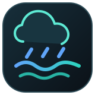
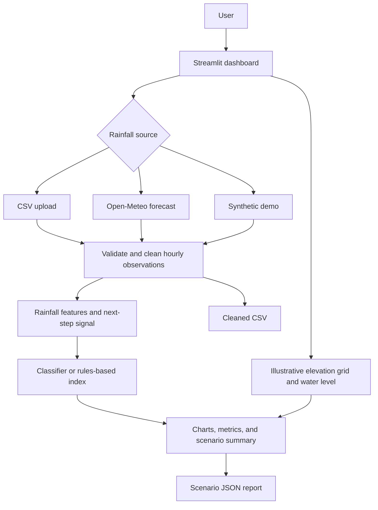

<p align="center">
  
</p>

<h1 align="center">Rainfall &amp; Inundation Monitor</h1>
<p align="center">
  <strong>Explore hourly rainfall. Review the next-step signal. Visualise a simplified inundation scenario.</strong><br />
  A local-first Streamlit workspace for rainfall CSVs, Open-Meteo forecasts, and synthetic demonstrations.
</p>

<p align="center">
  <a href="https://github.com/k-vandith/rainfall-inundation-prediction/actions/workflows/tests.yml"></a>
  
  
  
  
</p>

---

## What is Rainfall & Inundation Monitor?

A compact workspace for exploring hourly precipitation, a next-step heavy-rain signal, and a **simplified bathtub-style elevation-grid scenario**. Choose the input source, inspect the timeline and summary metrics, then export the cleaned observations and scenario details.

- **Choose your data:** validated CSV upload, Open-Meteo hourly forecast, or an explicitly selected synthetic demo.
- **Inspect the signals:** rainfall timeline, rolling totals, next-step heavy-rain signal, and illustrative water-level grid.
- **Export a run:** cleaned rainfall observations as CSV and scenario summary as JSON.

> **Research/demo use only.** This app is not an operational flood model or an official warning service. The elevation grid is illustrative and does not represent surveyed terrain, drainage, or local hydrology.

## Quick start

Python 3.12 is used by the CI workflow. From a terminal:

```bash
git clone https://github.com/k-vandith/rainfall-inundation-prediction.git
cd rainfall-inundation-prediction
python -m venv .venv
```

Activate the environment and install the app:

**Windows · PowerShell**
```powershell
.venv\Scripts\Activate.ps1
python -m pip install -r requirements.txt
python run.py
```

**macOS · Linux**
```bash
source .venv/bin/activate
python -m pip install -r requirements.txt
python run.py
```

Open **[http://127.0.0.1:8501](http://127.0.0.1:8501)**. The launcher binds to loopback and keeps Streamlit's request-origin protections enabled.

## Use it

1. Select **Synthetic demo** to explore the dashboard offline, or choose **Open-Meteo forecast** to request hourly precipitation for a latitude and longitude.
2. To analyse observations, choose **CSV upload** and provide a file with a `precipitation_mm` or `rainfall_mm` column. A date/time column is optional; when supplied, timestamps must be unique and one hour apart.
3. Review the rainfall timeline, latest and peak readings, rolling total, heavy-rain signal, and illustrative grid scenario.
4. Export cleaned observations as CSV or the scenario report as JSON.

A downloadable CSV template is available in the app. CSV uploads are limited to **5 MB / 100,000 rows** and need at least five valid, non-negative rainfall observations.

## Architecture



The heavy-rain classifier targets whether the **next time step** crosses a rainfall threshold. It does not predict inundation. Holdout accuracy is reported only for uploaded observed rainfall; forecasts and synthetic samples do not provide independent observed ground truth.

## Tests and development

Install development dependencies and run the checks:

```bash
python -m pip install -r requirements-dev.txt
ruff check src/app.py src/rain_features.py src/ui_theme.py run.py tests
bandit -q -r src/app.py run.py -ll
pip-audit -r requirements.txt --progress-spinner off
pytest -q
```

GitHub Actions runs Ruff, Bandit, dependency auditing, and the test suite for pushes and pull requests targeting `main`.

## Privacy and limitations

- CSV processing runs in the local app. Choosing Open-Meteo requires an internet request to retrieve forecast data.
- The dashboard has no user authentication. Keep it on loopback; do not expose it directly to an untrusted network.
- The heavy-rain signal is not a calibrated flood probability. A rules-based index may be used if a classifier cannot be trained.
- The bathtub grid and alert band are illustrative; they do not include surveyed elevation, drainage, river dynamics, or local emergency thresholds.
- Validate with trusted observations and local hydrological expertise before any operational use. Do not treat outputs as official alerts.

## Project map

```text
assets/
  rainfall-inundation-logo.svg   Project logo
src/
  app.py                         Streamlit dashboard
  rain_features.py               Rainfall features and signal modelling
  rainfall.py                    Rainfall data utilities
  ui_theme.py                    Dashboard styling
scripts/                         Setup and demo-data helpers
tests/                           Feature, workflow, and UI smoke tests
run.py                           Loopback-only launcher
```

## License

MIT. See [LICENSE](LICENSE).
